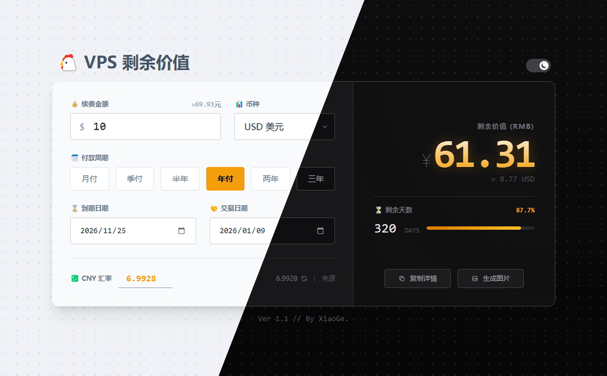

# 🐔 VPS 剩余价值计算器 (vps-jsq)

一个轻量美观的 VPS 剩余价值计算器，支持多币种实时汇率、自定义汇率、日均成本展示、参数链接分享、Markdown 复制与交易卡片 PNG 导出，开箱即用 **Docker 3000 端口** 部署。



## ✨ 特性

- 🐳 **Docker 轻量部署**：基于 `nginxinc/nginx-unprivileged:1.27-alpine` 非 root 多阶段构建，默认监听 **3000** 端口，支持 `linux/amd64` 与 `linux/arm64`，内置 `/healthz` 健康检查与 Gzip 压缩
- 💰 **多币种智能汇率**：支持 CNY / USD / EUR / GBP / JPY / KRW / HKD / TWD / CAD / SGD / AUD，一次拉取全币种缓存 12 小时，支持多源容错、离线参考汇率兜底，且刷新页面不覆盖自定义汇率
- 📅 **精准日期与日均计算**：基于 UTC 日历天数精确计算剩余天数、剩余价值、日均成本与已到期提示
- 🖼️ **交易卡片一键导出**：纯前端生成高清 PNG 卡片，支持一键下载与剪贴板复制，无隐私泄露
- 🔗 **快捷分享与重置**：支持复制 Markdown 详情、URL 参数分享链接（自动还原参数）与一键重置
- 🎨 **深色 / 浅色主题**：响应式布局，适配 PC 与移动端

---

## 🚀 Docker 部署（端口 3000）

### 方式一：Docker CLI 一键启动

```bash
docker run -d \
  --name vps-jsq \
  -p 3000:3000 \
  --restart unless-stopped \
  bbplin/vps-jsq:latest
```

启动后访问：`http://<你的服务器IP>:3000`
健康检查地址：`http://<你的服务器IP>:3000/healthz`

### 方式二：Docker Compose

```bash
docker compose up -d
```

`docker-compose.yml` 默认拉取 `bbplin/vps-jsq:latest` 并映射 `3000:3000` 端口。如需本地自行构建，取消 `docker-compose.yml` 中 `build: .` 的注释即可：

```bash
docker compose up -d --build
```

### 方式三：本地构建镜像

```bash
docker build -t vps-jsq:local .
docker run -d --name vps-jsq -p 3000:3000 --restart unless-stopped vps-jsq:local
```

---

## 🛠️ 本地开发与测试

本项目使用 Vite + Tailwind CSS，开发服务器与预览服务器均统一使用 **3000** 端口。

```bash
# 1. 安装依赖
npm install

# 2. 运行单元测试
npm test

# 3. 启动本地开发服务器 (http://localhost:3000)
npm run dev

# 4. 构建生产环境代码（输出至 dist/）
npm run build

# 5. 本地预览生产构建 (http://localhost:3000)
npm run preview
```

---

## ⚙️ GitHub Actions 自动构建

仓库内置 `.github/workflows/docker-publish.yml`：
- 每次推送到 `main` 分支或提交 PR 时，自动运行单元测试、Vite 生产构建以及 Docker 3000 端口容器冒烟测试
- 支持自动推送多架构镜像（`linux/amd64`, `linux/arm64`）至 GHCR 及 Docker Hub（在仓库 Secrets 中配置 `DOCKERHUB_USERNAME` 与 `DOCKERHUB_TOKEN` 即可开启自动同步推送到 Docker Hub）

---

## 📝 许可证

MIT License（原作者：[XiaoGe](https://www.xiaoge.org/)）
